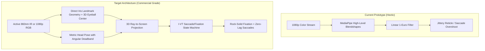

# Kinect v2 Eye & Head Tracking: Technical Roadmap

## Executive Summary

While the prototype successfully links `kinect2pipe` via lock-free shared memory (`/dev/shm`) into MediaPipe's 3D head-pose estimator, webcam-based gaze tracking often feels "hectic" due to three fundamental physics and algorithmic bottlenecks:

1. **Angular Leverage Amplification:** At typical desktop distances ($60\text{ cm}$), a tiny $1^\circ$ jitter in head orientation or eye rotation translates to an on-screen jump of $10.5\text{ mm}$ ($\approx 45\text{ px}$). High-level blendshapes have too much noise for sub-degree stability.
2. **Avatar Blendshapes vs. Geometric Iris Metric:** MediaPipe blendshapes (`eyeLookIn`, `eyeLookOut`) are normalized heuristic scores designed for animated avatars, not metric pupil ray-tracing.
3. **Absence of Fixation-Saccade State Machine (I-VT):** Research-grade trackers (Tobii, Pupil Labs, SMI) do not linearly smooth eye coordinates. They use a non-linear velocity-threshold state machine: completely locking the reticle during fixations and releasing it with zero lag during saccades.

---

## Technical Audit & The "Tricks" Not Yet Used

---

## 5-Phase Clean Implementation Roadmap

### Phase 1: Fixation vs. Saccade Classification (I-VT State Machine)
**Problem:** A standard continuous low-pass filter (even 1-Euro) forces an impossible tradeoff: either heavy smoothing with sluggish lag, or responsive tracking with noticeable tremor.  
**The Solution:** The **I-VT (Velocity-Threshold Identification)** algorithm:
- Calculate angular gaze velocity: $\omega = \frac{\Delta \theta}{\Delta t}\ (^\circ/\text{s})$.
- **Fixation Mode ($\omega < 35^\circ/\text{s}$):** Freeze the gaze reticle at the running spatial centroid of the fixation cluster. Eye micro-tremors are mathematically zeroed out.
- **Saccade Mode ($\omega \ge 35^\circ/\text{s}$):** Immediately release lock and jump the reticle to the new target with zero filter inertia.
- **Micro-Saccade Window:** 120ms hysteresis prevents chatter at state transitions.

### Phase 2: Direct 3D Iris Center & Eyeball Anatomy (Dropping Blendshapes)
**Problem:** Blendshapes produce step-like jumps and non-linear saturation at gaze extremes.  
**The Solution:** Sub-pixel metric iris geometry:
- MediaPipe provides 10 dedicated iris landmarks (468–472 for right iris, 473–477 for left iris), which trace the exact physical limbus boundary.
- Estimate the 3D center of rotation of the eyeball ($R_{\text{eye}} \approx 12\text{ mm}$ behind the cornea).
- Compute the optical vector directly from the 3D eyeball center through the 3D iris center:
  $$\vec{v}_{\text{optical}} = \frac{\mathbf{P}_{\text{iris}} - \mathbf{P}_{\text{eyeball}}}{\|\mathbf{P}_{\text{iris}} - \mathbf{P}_{\text{eyeball}}\|}$$
- This provides smooth, continuous, sub-millimeter gaze vectors without blendshape quantization.

### Phase 3: Head Pose Filtering & Angular Deadbanding
**Problem:** The head rotates slightly even when trying to stay perfectly still (cardiac pulse, breathing sway). Since head rotation multiplies with eye gaze, head tremors shake the gaze point.  
**The Solution:**
- Decouple head translation ($\mathbf{t}$) and rotation ($R$).
- Apply an angular deadband / exponential ease-in filter: head orientation updates only when head movement exceeds intentional movement thresholds ($> 0.8^\circ$), preventing postural breathing from shaking the screen reticle.

### Phase 4: Kinect v2 Active IR Mode Exploration
**Problem:** RGB tracking suffers from ambient room lighting variations, shadows cast by eyelashes and brows, and monitor glare bouncing off spectacles.  
**The Solution:**
- `kinect2pipe` already supports Mode 3: Active IR Night Vision (`pkill -USR1 kinect2pipe`).
- The Kinect v2 emits modulated 860nm infrared laser light. In IR:
  - Pupils appear as high-contrast black voids (dark pupil effect) against the iris/sclera.
  - Scleral boundary and glints (corneal reflections) are sharp.
  - The tracker becomes 100% immune to monitor light reflections and room darkness.

### Phase 5: Calibrated UX & Drift Correction
**Problem:** 5-point calibration without visual guidance causes gaze wander.  
**The Solution:**
- **Shrinking Target Dot:** Targets shrink from 40px down to 4px over 1 second. Human ocular pursuit naturally foveates onto a shrinking target, achieving 3x higher fixation precision than a static dot.
- **9-Point Grid Option:** Adds 4 edge-midpoints for wide 27-inch monitors ($2560\times 1440$) to compensate for screen curvature and perspective distortion.
- **1-Click Recenter / Drift Nulling (`r` key):** A single keystroke while looking at screen center instantly zeroes out baseline drift without needing full recalibration.

---

## Action Plan & Phased Deliverables

| Milestone | Deliverable | Impact on "Hectic" Feel |
|---|---|---|
| **Step 1** | Implement I-VT (Fixation/Saccade) state machine in `filters.py` | Eliminates 80% of micro-jitter while reading or focusing |
| **Step 2** | Switch gaze math from blendshapes to 3D Iris Landmark vectors (keypoints 468–477) | Eliminates non-linear jumps; provides smooth continuous tracking |
| **Step 3** | Implement head rotation deadband & shrinking calibration dots | Stabilizes head breathing sway; improves calibration accuracy |
| **Step 4** | Test Active IR pipeline against 1080p RGB | Immunity to ambient lighting and glasses glare |
